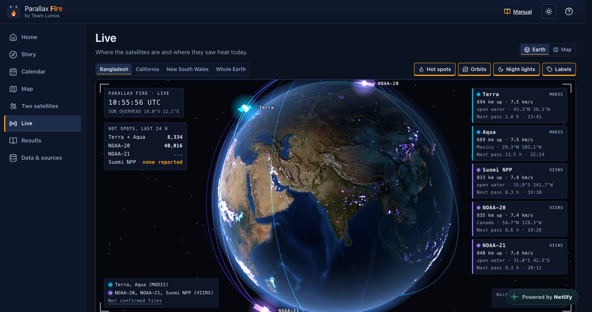
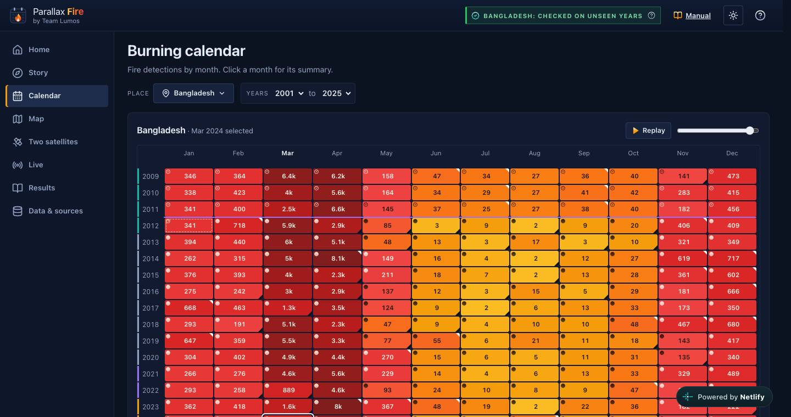
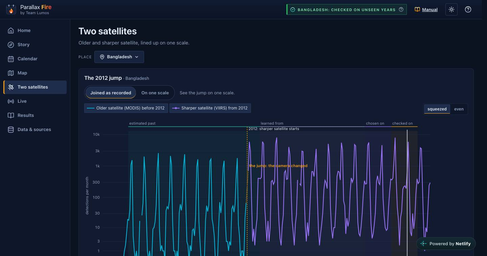
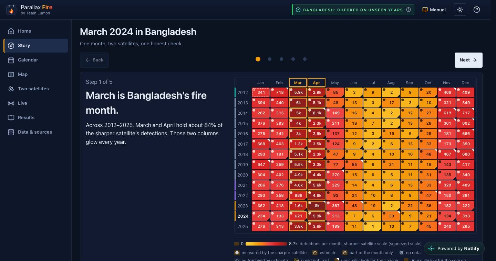
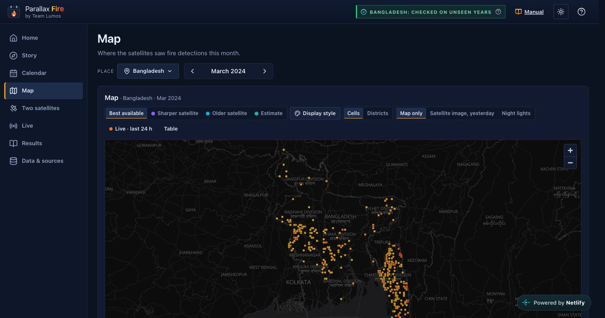
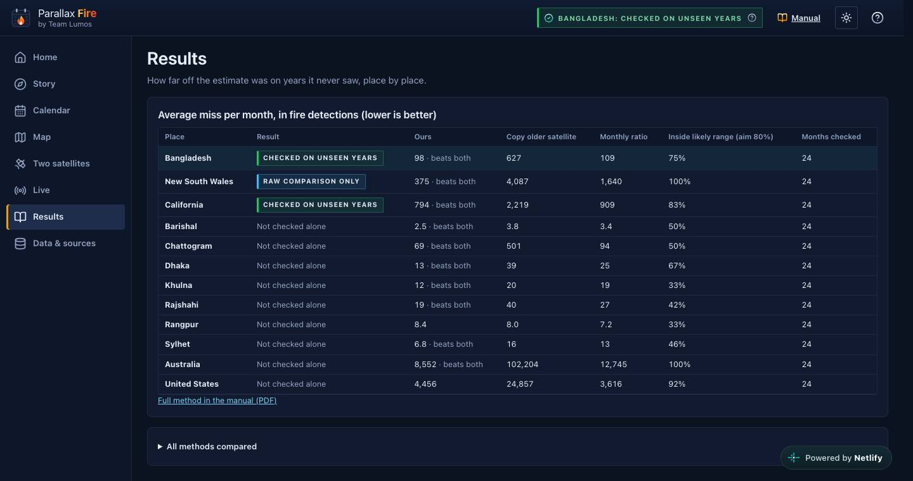
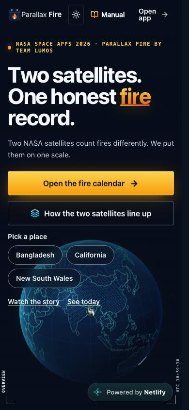
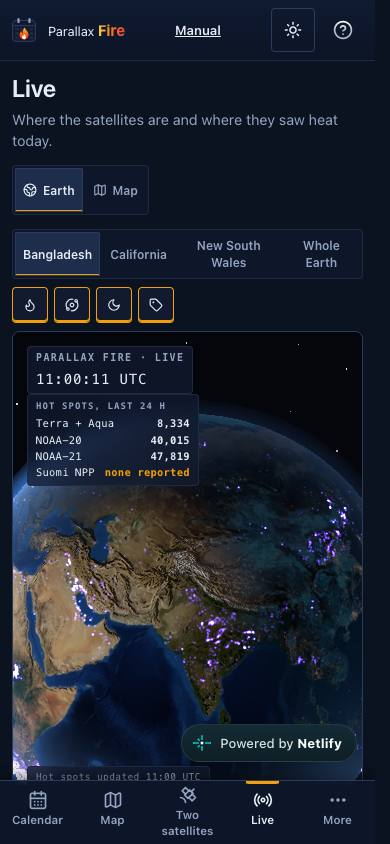
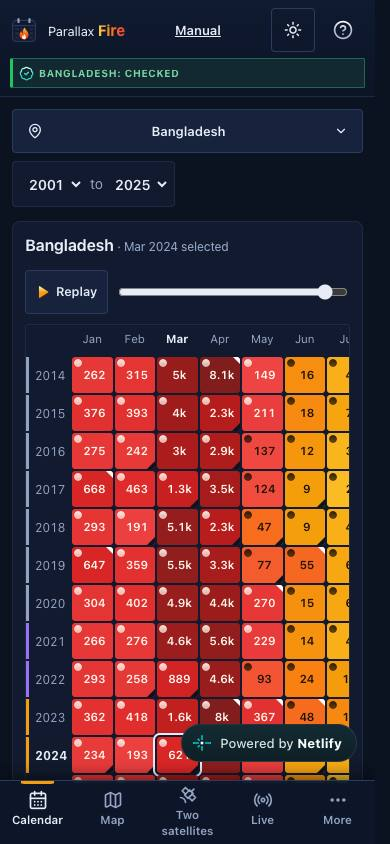
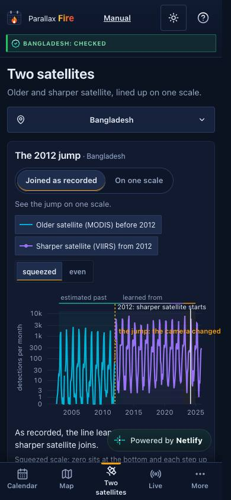

# Parallax Fire

**Same fires. Two cameras. One honest record.**

NASA Space Apps Challenge 2026 · *Harmonization of MODIS and VIIRS Hot Spots* · **Team Lumos**, Dhaka, Bangladesh · created by M Al Shahriar Hameem

### Live app: **https://parallaxfire.netlify.app**
User and method manual (PDF): **https://parallaxfire.netlify.app/Parallax-Fire-Manual.pdf**

NASA's older MODIS satellites see fires in 1 km pixels; the sharper VIIRS satellites (from 2012) see them in 375 m pixels and record several times more detections. Join the two records and burning seems to jump in 2012, mostly because the camera changed. Parallax Fire puts both on one fair scale, shows each place's burning seasons month by month, and shows where the fire satellites are and what they saw today.

## Screens

| Live Earth (real satellites, real sun, today's hot spots) | Burning calendar |
|---|---|
|  |  |
| **Two satellites, one scale** | **Story: March 2024 in Bangladesh** |
|  |  |
| **Map** | **Results by place** |
|  |  |

     

All screenshots are of the live site (dark theme; a light theme is on the toggle). More in [`docs/screenshots/`](docs/screenshots/).

## What it does
- **Live:** a three.js Earth with NASA imagery, night lights and relief, lit by the real sun; Terra, Aqua, Suomi NPP, NOAA-20 and NOAA-21 at their real positions (orbit records from CelesTrak, propagated in the browser); today's NASA FIRMS detections, counted per satellite. A flat map view is one tab away.
- **Calendar:** 2001–2025 by month for Bangladesh (and its divisions), California and New South Wales (plus whole USA and Australia as totals).
- **Two satellites:** one switch shows the records as joined and on one scale.
- **Map:** 5 km squares or Bangladesh districts on a real basemap.
- **Story:** March 2024 in Bangladesh, step by step, with the real numbers.
- **Results** and **Data & sources:** how well the estimate held up on years it never saw, per place; every source, with downloads.

Everything else (the method, results, sources, licences, limits, glossary) is in the [manual](https://parallaxfire.netlify.app/Parallax-Fire-Manual.pdf).

## Results (from the real Kaggle run, years 2023–2024 held back for checking)
| Place | Our estimate: average miss per month | Older satellite's count as it is | Simple monthly rule | Result |
|---|---|---|---|---|
| Bangladesh | 98 | 627 | 109 | holds up |
| California | 794 | 2,219 | 909 | holds up |
| New South Wales | 375 | 4,087 | 1,640 | raw comparison only (likely range too wide) |

Source: `parallax_app/apps/web/public/data/parallax-20261010T190934Z-ce88f489/metrics.json` (24 checked months per place).

## Honest limits
- A hot spot is a satellite detection, not a confirmed wildfire; crop burning is included. Cloud hides fires, so no detection never means no fire. Missing months are shown as missing, never as zero.
- The app describes past burning and today's detections. It does not forecast fires.
- Live data is near-real-time and may be revised. NASA's Suomi NPP live feed is currently empty and is shown as such; NASA is ending S-NPP data delivery (2 Nov 2026).
- Not yet tested on real phones by users; tested in desktop and phone-sized browsers.

## Repository
| Path | What it holds |
|---|---|
| `parallax_app/` | The web app (React, Vite, TypeScript, three.js, GSAP, MapLibre, satellite.js), Netlify functions for live data, tests, specs (`docs/`), manual source (`docs/manual/`) |
| `kaggle_notebooks/` | Notebook A (download NASA FIRMS data) and Notebook B (train and export), run on Kaggle |
| `video/` | Pitch video script with sources, captions (`.srt`); the builder is `parallax_app/scripts/video/make_video.mjs` |
| `docs/screenshots/` | Screenshots of every page |

Run locally (Node 20+): `cd parallax_app && npm install && npm run dev` → http://localhost:5173. Tests: `npm test`. Checks used during development: `parallax_app/scripts/goals/`.

## Data and credits
NASA FIRMS active-fire detections (MODIS Collection 6.1; VIIRS 375 m) · NASA EOSDIS GIBS imagery · Blue Marble and night-lights textures (NASA, via the three-globe project) · orbit records from CelesTrak · OpenFreeMap © OpenMapTiles, data © OpenStreetMap contributors · Natural Earth · geoBoundaries (CC BY 3.0 IGO).
We acknowledge the use of data and imagery from NASA's Fire Information for Resource Management System (FIRMS), part of NASA's Earth Observing System Data and Information System (EOSDIS).
