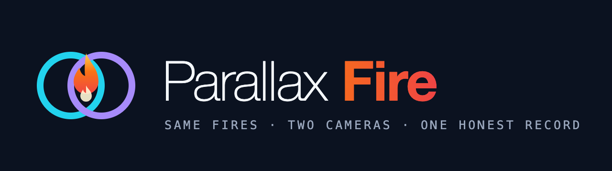
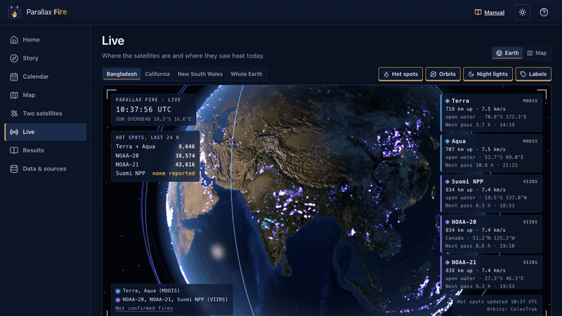
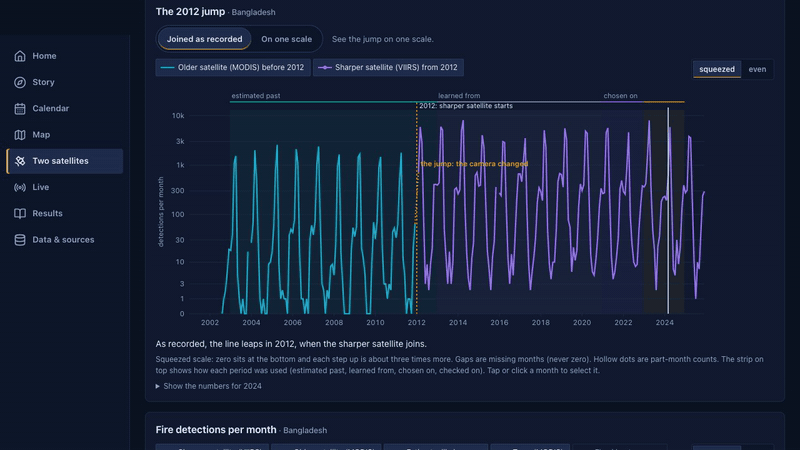
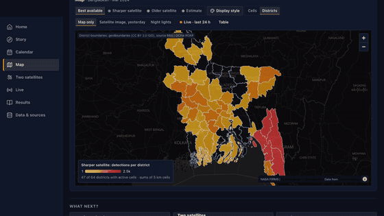
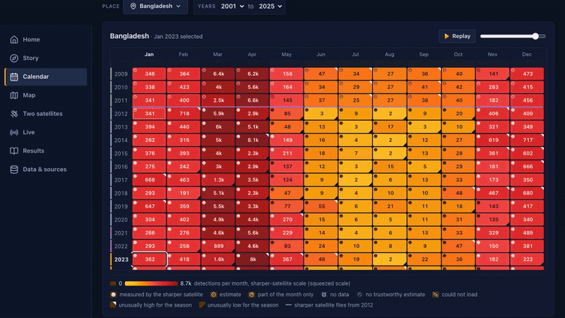
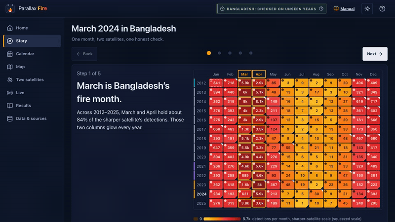
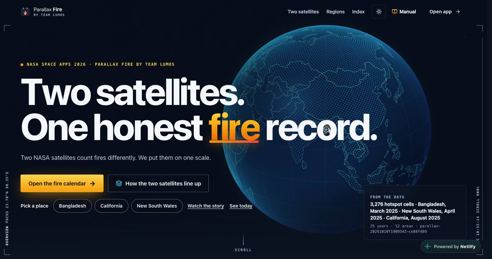
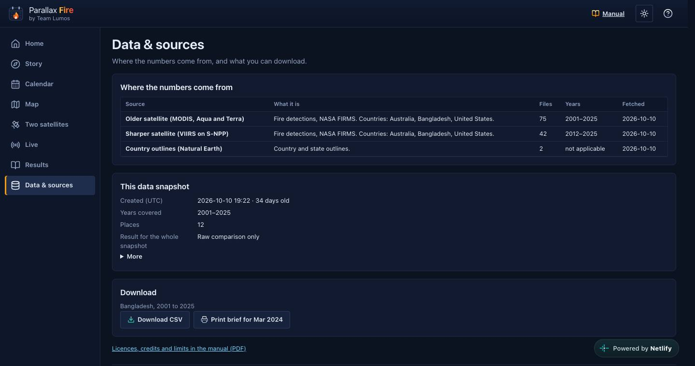
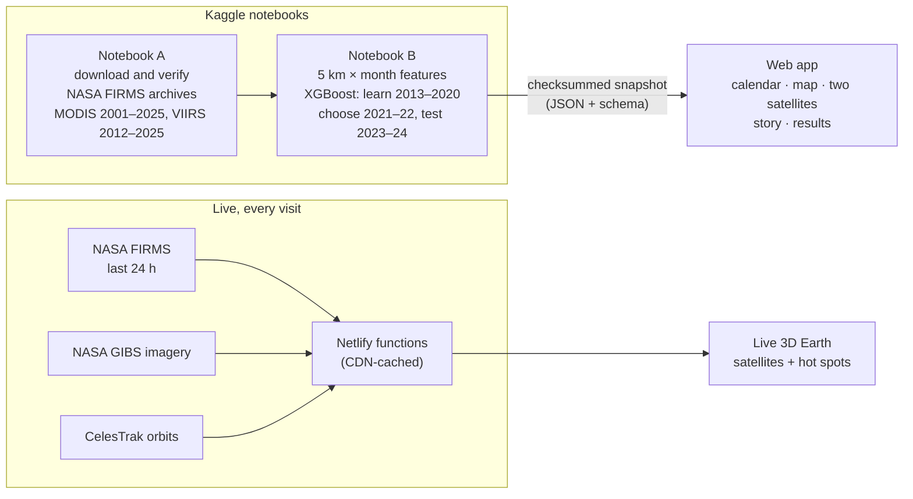

<div align="center">



### Same fires. Two cameras. One honest record.

NASA's MODIS and VIIRS fire detections, put on one fair scale: a 25-year burning calendar, district maps and a live 3D Earth.

[](https://parallaxfire.netlify.app)
[](https://youtu.be/Y13heGQp3xo)
[](https://youtu.be/YClSb3WXftQ)

[](https://www.spaceappschallenge.org/2026/find-a-team/lumos2/)
[](https://www.spaceappschallenge.org/2026/find-a-team/lumos2/)
[](LICENSE)
[](LICENSE-CONTENT.md)

**Team Lumos** · Dhaka, Bangladesh · created by M Al Shahriar Hameem

</div>

<p align="center"></p>

---

## Contents
- [Videos](#videos)
- [The problem](#the-problem)
- [What Parallax Fire does](#what-parallax-fire-does)
- [How it works](#how-it-works)
- [Results](#results)
- [Honest limits](#honest-limits)
- [Run it yourself](#run-it-yourself)
- [Repository layout](#repository-layout)
- [Documentation](#documentation)
- [Team Lumos](#team-lumos)
- [Use of AI tools](#use-of-ai-tools)
- [Data sources and credits](#data-sources-and-credits)
- [Licence](#licence)

## Videos

| 30-second demo | 240-second pitch |
|:---:|:---:|
| [](https://youtu.be/Y13heGQp3xo) | [](https://youtu.be/YClSb3WXftQ) |
| The idea in 30 seconds | The full story: the problem, a real test, the app and what comes next |

Scripts, timings and the source of every spoken fact: [`video/SCRIPT_240s.md`](video/SCRIPT_240s.md). Subtitles are in [`video/`](video/).

## The problem

NASA has watched fires from space for more than 20 years, but with two different cameras:

| | MODIS (Terra and Aqua) | VIIRS (Suomi NPP, NOAA-20, NOAA-21) |
|---|---|---|
| Since | 2000 | 2012 |
| Pixel size | 1 km | 375 m |
| Detections in Bangladesh | 1× | about **5×** (it sees smaller fires) |

Join the two records and burning seems to leap in 2012. Mostly, the camera changed, not the fire. Someone comparing 2005 with 2020 could ask for help against a change that never happened on the ground.

## What Parallax Fire does

| One switch, one scale | Every district, mapped |
|:---:|:---:|
|  |  |
| **Two satellites:** see both records joined as recorded, then press *On one scale* and most of the 2012 jump disappears. | **Map:** 5 km squares or Bangladesh's 64 districts on a real basemap, with NASA satellite imagery. |
| **25 years, month by month** | **A real test, step by step** |
|  |  |
| **Calendar:** 2001–2025 for Bangladesh and its divisions, California and New South Wales. *Replay* plays the months like a film. | **Story:** March 2024 in Bangladesh. VIIRS counted 621, MODIS 111; from MODIS alone we estimated about 1,093 (likely 571–1,529), and the real 621 fell inside. |

- **Live:** a three.js Earth lit by the real Sun, with Terra, Aqua, Suomi NPP, NOAA-20 and NOAA-21 at their real positions and the last 24 hours of NASA FIRMS hot spots, counted per satellite.
- **Results** and **Data & sources:** how well the estimate held up on years it never saw, per place, and every source with downloads.
- **[User and method manual (PDF)](https://parallaxfire.netlify.app/Parallax-Fire-Manual.pdf):** every page, the method, the results, the limits and a glossary.

<details>
<summary><b>Screenshots of every page</b> (laptop and phone)</summary>

| Live Earth | Burning calendar |
|---|---|
|  |  |
| **Two satellites, one scale** | **Story: March 2024 in Bangladesh** |
|  |  |
| **Map** | **Results by place** |
|  |  |
| **Home** | **Data & sources** |
|  |  |

<p align="center">
  
  
  
  
</p>

All screenshots are of the live site in the dark theme (a light theme is on the toggle).
</details>

## How it works



1. **Learn only where both cameras watched.** The model sees each 5 km square and month from both satellites, 2013–2020, and learns how a MODIS count relates to the VIIRS count.
2. **Choose and test honestly.** The method was chosen on 2021–2022, then tested once on 2023–2024, years it never saw.
3. **Report per place.** A place earns the estimate only if it beats two simple rules *and* its likely range covers about 8 in 10 real values. Otherwise the app shows the raw records only, and says so.

## Results

Years 2023–2024 were held back for checking (24 months per place). Average miss per month, in fire detections (lower is better):

| Place | Our estimate | Older satellite's count as it is | Simple monthly rule | Result |
|---|---:|---:|---:|---|
| Bangladesh | **98** | 627 | 109 | holds up |
| California | **794** | 2,219 | 909 | holds up |
| New South Wales | **375** | 4,087 | 1,640 | raw comparison only (likely range too wide) |

Source: [`metrics.json`](parallax_app/apps/web/public/data/parallax-20261010T190934Z-ce88f489/metrics.json) of the real Kaggle run.

## Honest limits
- A hot spot is a satellite detection, not a confirmed wildfire; crop burning is included. Cloud hides fires, so no detection never means no fire. Missing months are shown as missing, never as zero.
- The app describes past burning and today's detections. It does not forecast fires.
- Live data is near-real-time and may be revised. NASA's Suomi NPP live feed is currently empty and is shown as such; NASA is ending S-NPP data delivery (2 Nov 2026).
- Not yet tested with real users on real phones; tested in desktop and phone-sized browsers.

## Run it yourself

```bash
git clone https://github.com/Shahriar290900/Harmonisation-MODIS-VIIRS.git
cd Harmonisation-MODIS-VIIRS/parallax_app
npm install
npm run dev      # http://localhost:5173
npm test         # unit tests
npm run build    # production build in parallax_app/dist
```

- **Reproduce the data:** run the two notebooks in [`kaggle_notebooks/`](kaggle_notebooks/) on Kaggle, step by step with [`STEP_INDEX.md`](kaggle_notebooks/STEP_INDEX.md), then import the bundle with `npm run import-bundle -- parallax_app_bundle.zip`.
- **Deploy:** Netlify builds every push to `main` using [`netlify.toml`](netlify.toml).
- **More:** [developer guide](parallax_app/README.md).

## Repository layout

```text
.
├── parallax_app/            web app (React, TypeScript, Vite, three.js, MapLibre), Netlify functions, tests, specs
│   ├── apps/web/            app source and public assets (data snapshots, manual PDF, textures)
│   ├── netlify/functions/   live NASA FIRMS, NASA GIBS and CelesTrak endpoints
│   ├── notebooks/           notebook sources and their tests
│   └── scripts/             bundle import, manual, checks, video and GIF builders
├── kaggle_notebooks/        Notebook A (fetch) and Notebook B (train), as run on Kaggle
├── docs/                    documentation index, GIFs and team image, screenshots, archive
├── branding/                Parallax Fire and Team Lumos logos (SVG, PNG)
├── video/                   video scripts and subtitles
├── LICENSE                  MIT (code)
├── LICENSE-CONTENT.md       CC BY 4.0 (docs and media)
├── THIRD_PARTY_NOTICES.md   data, library and asset licences
└── CITATION.cff             how to cite
```

## Documentation
- **[Documentation index](docs/README.md):** every document, grouped for users, developers and data.
- **[User and method manual (PDF)](https://parallaxfire.netlify.app/Parallax-Fire-Manual.pdf)**
- **[Developer guide](parallax_app/README.md)**
- **[Kaggle step-by-step guide](kaggle_notebooks/STEP_INDEX.md)**
- **[Live data sources](parallax_app/docs/LIVE_SOURCES.md)** and **[source check](parallax_app/docs/SOURCE_CHECK.md)**

## Team Lumos

<p align="center"></p>

**M Al Shahriar Hameem** (team lead) · Tuasin Taj Fiha · Afifa Asif · Md Abu Ammar · Kausar Ahmed · Sabiha Akter
University of Liberal Arts Bangladesh · NASA Space Apps Challenge 2026, Dhaka · [team page](https://www.spaceappschallenge.org/2026/find-a-team/lumos2/)

## Use of AI tools
In line with the NASA Space Apps rules on Super Intelligence (SI) tools:
- **Code and text:** written with Claude (Anthropic), through Claude Code, as a coding and writing assistant: the web app, live-data functions, Kaggle notebooks, tests, manual and video builder. Commits it helped with carry a `Co-Authored-By: Claude` line. Every number shown comes from our own Kaggle run (`metrics.json`), not from the AI.
- **Model experiment:** Qwen2.5-7B-Instruct (open model, run offline in Notebook B) proposed settings for an experimental quantum-circuit model in a side comparison. It was not selected; the fire estimate is a conventional machine-learning model (XGBoost).
- **Audio:** the narration in both videos is AI-generated (Kokoro-82M text-to-speech). This is stated on the videos' end cards, in the video file metadata and in the video descriptions.
- **Images:** MODNet (run locally) removed the backgrounds of the team photos in the team image and the 240-second video. No AI-generated images are used. The app's footage in the videos and GIFs is a screen capture of the real site.

## Data sources and credits

| Source | Used for | Licence or terms |
|---|---|---|
| [NASA FIRMS](https://www.earthdata.nasa.gov/data/tools/firms): MODIS C6.1 and VIIRS 375 m, archive and near-real-time | The 2001–2025 record, the model and today's hot spots | NASA open data |
| [NASA GIBS](https://nasa-gibs.github.io/gibs-api-docs/) | Satellite imagery and night lights on the map | NASA open data |
| [NASA Blue Marble and Black Marble](https://science.nasa.gov/earth/earth-observatory/collections/blue-marble/) (via [three-globe](https://github.com/vasturiano/three-globe)) | Textures of the 3D Earth | NASA imagery; three-globe MIT |
| [CelesTrak](https://celestrak.org/NORAD/elements/) | Satellite orbits | Public orbital data |
| [geoBoundaries](https://www.geoboundaries.org) | Bangladesh district outlines | CC BY 3.0 IGO |
| [Natural Earth](https://www.naturalearthdata.com) | Country and state outlines | Public domain |
| [OpenFreeMap](https://openfreemap.org) (© OpenMapTiles, © OpenStreetMap contributors) | Basemap | ODbL / CC BY 4.0 |
| "Voltaic" Kevin MacLeod ([incompetech.com](https://incompetech.com)) | Music in the 30-second video | CC BY 4.0 |

We acknowledge the use of data and imagery from NASA's Fire Information for Resource Management System (FIRMS), part of NASA's Earth Observing System Data and Information System (EOSDIS), and of imagery from NASA's Global Imagery Browse Services (GIBS), part of NASA's Earth Science Data and Information System (ESDIS). Libraries and full terms: [THIRD_PARTY_NOTICES.md](THIRD_PARTY_NOTICES.md).

## Licence
- **Code:** [MIT](LICENSE), © 2026 M Al Shahriar Hameem.
- **Docs, logos, screenshots, GIFs, manual and video scripts:** [CC BY 4.0](LICENSE-CONTENT.md).
- **Third-party data and libraries:** their own licences, listed in [THIRD_PARTY_NOTICES.md](THIRD_PARTY_NOTICES.md).
- NASA and NASA Space Apps names and logos belong to their owners; no endorsement is implied.

To cite this project, use [`CITATION.cff`](CITATION.cff) (GitHub's "Cite this repository" button).
